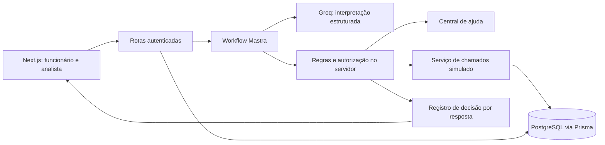

# Nexo Assist

Service desk de TI conversacional para o desafio Beyond the Bytes. O funcionário resolve dúvidas, consulta seus chamados e confirma rascunhos de criação, atualização ou reabertura. O analista recebe o contexto, assume a conversa, responde e a devolve ao agent ou encerra.

Interface baseada no [protótipo do Pencil](https://app.pen.dev/s/swhm7Xfy1krKDIc-QyqE9J8ZI2xFB0qbNvHIncCXcLg), com Newsreader, Schibsted Grotesk, IBM Plex Mono e os mesmos padrões de layout, cores e estados. Os registros iniciais são fictícios. Prazos são calculados pelas regras do PRD, sem prometer resolução antes de uma reunião.

## Rodar com Docker

Requisitos: Docker com Compose v2, inclusive pelo WSL. Não é necessário instalar Node ou PostgreSQL no host.

```sh
cp .env.example .env
# Para IA real: preencha GROQ_API_KEY no .env.
docker compose up --build -d
```

No PowerShell, substitua a primeira linha por `Copy-Item .env.example .env`. No Windows com Docker somente no WSL, execute os comandos dentro da distribuição, na pasta do projeto em `/mnt/c/...`.

- Aplicação: http://localhost:3000
- Caixa de e-mail local: http://localhost:8025
- PostgreSQL local: porta 55435, configurável por `DB_PORT`.
- `docker compose logs -f app migrate` mostra a inicialização.
- `docker compose down` encerra os containers e preserva o volume do banco.

O serviço `migrate` aplica migrations e executa o seed antes da aplicação. O seed preserva usuários, chamados e conversas existentes. O banco possui volume persistente; reiniciar ou reconstruir a aplicação não apaga o histórico.

Sem uma chave, consultas explícitas, rascunhos de exemplo e atendimento humano continuam disponíveis. Para testar o roteiro completo offline, defina **explicitamente** `AI_MODE=scripted` e recrie a aplicação com `docker compose up -d app`. Uma faixa informa que as respostas são roteirizadas. Esse modo não é fallback de falhas nem substitui a avaliação de IA real.

## Acessos de demonstração

Com `AUTH_MODE=demo`, use qualquer senha não vazia:

| Usuário | E-mail | Papel |
| --- | --- | --- |
| Ana Souza | ana.souza@nexo.com.br | Funcionária, Windows 11 |
| Carla Mendes | carla.mendes@nexo.com.br | Funcionária |
| Diego Ramos | diego.ramos@nexo.com.br | Funcionário, Windows 10 |
| Fábio Nunes | fabio.nunes@nexo.com.br | Funcionário |
| Rafael Lima | rafael.lima@nexo.com.br | Analista, Suporte N2 |
| Marina Costa | marina.costa@nexo.com.br | Analista, Suporte N1 |

O seed cria nove usuários, oito artigos, sete chamados e históricos que cobrem abertura, atraso, resolução recente, resolução antiga e chamados de outro funcionário. Ana começa com o rascunho de VPN do protótipo; “Nova conversa” inicia um atendimento vazio. Há também conversas aguardando analistas no console.

## Desenvolvimento sem container da aplicação

Requer Node.js 24 e pnpm 11.25.0. O PostgreSQL e o Mailpit podem continuar no Docker.

```sh
corepack enable
pnpm install --frozen-lockfile --ignore-scripts
pnpm db:generate
docker compose up -d db mailpit
pnpm db:setup
pnpm dev
```

## Arquitetura e decisões



- **Uma aplicação, responsabilidades separadas:** interface em `src/components`, orquestração em `src/agent`, regras em `src/domain` e serviços em `src/services`. O legado é uma camada própria, substituível por integração HTTP. Separação de responsabilidades não exige múltiplos servidores para este desafio.
- **Mastra:** um workflow executa a interpretação tipada. O agent recebe apenas evidências do funcionário autenticado e retorna intenção, entidades, confiança estimada e justificativa breve. Zod valida a saída. Nenhuma decisão de autorização depende do modelo.
- **Groq / GPT-OSS 120B:** plano gratuito, saída estruturada e configuração por ambiente. A classificação e a resposta textual são chamadas separadas, pois o provedor não combina saída estruturada com streaming. Operações de negócio usam texto gerado pelo servidor; respostas de conhecimento podem usar uma segunda chamada em streaming, fundamentada nos artigos.
- **PostgreSQL + Prisma:** persistência compartilhada, migrations versionadas, transações, bloqueios por funcionário e controle otimista de versões. Isso permite testar concorrência e evita depender do disco efêmero de hospedagens.
- **Busca textual:** oito artigos curtos não justificam embeddings ou banco vetorial. A busca normaliza termos e verifica a aplicabilidade por sistema operacional. Evidências incompatíveis não devem produzir instruções de resolução.
- **Tempo real:** SSE para progresso e resposta do agent; atualização periódica de 3,5 segundos para sincronizar funcionário e analista. A escolha reduz infraestrutura e funciona em hospedagem serverless. Com maior escala, substituiria a consulta periódica por um canal de eventos.

## Regras executadas no servidor

- INC quando algo parou; REQ para acesso, equipamento ou software. Categorias: Acesso, Rede e VPN, Hardware, Software, E-mail e Outros.
- Impacto e urgência determinam prioridade. Equipe/empresa parada é crítica; pessoa impedida de trabalhar ou compromisso hoje é alta; com alternativa é média; sem urgência é baixa.
- SLA: crítica em uma hora corrida; alta em quatro horas úteis; média em trinta horas de expediente; baixa em cinquenta. Expediente: segunda a sexta, 8h–18h, `America/Sao_Paulo`, sem feriados neste calendário demonstrativo.
- Prazo para primeira resposta e cada atualização; nunca garantia de resolução. A atualização confirmada reinicia o prazo. Resolvidos não são considerados vencidos.
- Criação, atualização e reabertura exigem rascunho e confirmação. A confirmação é idempotente. Um novo duplicado descoberto durante a confirmação transforma o rascunho em atualização e exige nova confirmação.
- Reabertura até sete dias corridos após resolução. A similaridade textual é uma heurística conservadora por categoria e proprietário; casos ambíguos devem pedir esclarecimento ou analista.
- Transferência por preferência, criticidade, SLA vencido ou confiança abaixo de 65%. Esse limiar é uma escolha do projeto, não confiança calibrada.
- Estados persistidos: `AGENT`, `WAITING_ANALYST`, `HUMAN`, `CLOSED`. Assumir conversa é atômico. Uma resposta em processamento precisa validar o responsável antes de publicar ou gravar; enquanto há analista, novas mensagens não invocam IA.
- Trinta mensagens do funcionário com o agent por conversa. Transferência e mensagens com analista permanecem disponíveis no limite. Ações de confirmar/editar/cancelar rascunho não consomem chamada de LLM.
- Funcionários nunca recebem chamados alheios. Filtros por proprietário são aplicados antes do contexto do modelo e novamente antes da gravação. O console exige papel de analista.

## Transparência

“Ver decisão” mostra intenção, evidências, fontes, confiança estimada, regras aplicadas e resultado/duração das operações. É um resumo operacional verificável, não uma exposição de raciocínio privado do modelo. As ações indicam execução real; o histórico inicial informa que é um exemplo do protótipo.

O legado permite `LEGACY_FAILURE_RATE` entre 0 e 1 para simular falhas transitórias. São realizadas até três tentativas com espera crescente. Falha não é apresentada como chamado criado. Para testar a indisponibilidade total, use `LEGACY_FAILURE_RATE=1` e volte para `0` após a demonstração.

## Autenticação real opcional

`AUTH_MODE=demo` atende ao login simulado pedido no PRD. Em uma instalação separada com banco vazio, use `AUTH_MODE=password` e `SEED_PASSWORD` de pelo menos 12 caracteres para provisionar os usuários iniciais. O seed não redefine credenciais de usuários existentes. O projeto não possui cadastro público.

No modo real, senhas usam scrypt com salt; sessões são opacas, armazenadas como hash, expiram e são revogáveis. Recuperação envia link de uso único válido por 30 minutos, guarda somente o hash do token e revoga sessões após a alteração. A resposta de solicitação não revela se o e-mail existe. Falhas de envio preservam essa resposta genérica e invalidam o token não entregue.

No Docker local, o SMTP aponta para o Mailpit. Para entrega externa, configure `SMTP_HOST`, `SMTP_PORT`, `SMTP_SECURE`, `SMTP_USER`, `SMTP_PASSWORD` e `SMTP_FROM`. Use um remetente autorizado no seu provedor. No deploy público demonstrativo, mantenha `AUTH_MODE=demo` e dados fictícios.

## Configuração e limites

Consulte `.env.example`. Principais variáveis:

| Variável | Uso |
| --- | --- |
| `DATABASE_URL` | Conexão da aplicação; usar pool no Neon |
| `DIRECT_URL` | Conexão de migrations/seed |
| `APP_URL` | URL canônica para origem, cookies e recuperação |
| `AUTH_MODE` | `demo` ou `password` |
| `AI_MODE` | `groq` ou `scripted` explicitamente identificado |
| `GROQ_API_KEY` | Chave exclusiva do servidor |
| `LLM_MODEL` | Padrão `groq/openai/gpt-oss-120b` |
| `MAX_DAILY_AI_CALLS` | Padrão 200 para a demonstração |
| `MAX_DAILY_AI_TOKENS` | Padrão 150000; rejeita novas chamadas após atingir o limite registrado |
| `MAX_MESSAGES_PER_MINUTE` | Padrão 6 por funcionário |
| `LEGACY_FAILURE_RATE` | Padrão 0; somente simulação controlada |

Há limite de entrada e saída, proteção de login e recuperação, limite de novas conversas e quotas persistidas no banco. Os limites dos provedores gratuitos podem mudar; a aplicação trata indisponibilidade e `429` sem trocar silenciosamente para um simulador. A quota diária de tokens é uma proteção aproximada de admissão; chamadas já iniciadas podem ultrapassá-la. Chaves, cookies e URLs de banco não entram no repositório.

## Testes e avaliação

```sh
pnpm typecheck
pnpm test
pnpm test:integration
pnpm build
pnpm exec playwright install chromium
# Aplicação rodando, AUTH_MODE=demo e AI_MODE=scripted:
pnpm test:e2e
# Somente com chave e AI_MODE=groq:
pnpm eval
```

Testes unitários cobrem prioridades, calendário, reabertura e duplicidade. Integração usa PostgreSQL real e registros isolados para validar idempotência concorrente, autorização, limite de sessão, transação e falha do legado. Playwright cobre as telas, perfil, edição/confirmação de rascunho, persistência e conversa entre funcionário e analista com o agent pausado.

`scripts/test-password.ts` valida entrega no Mailpit, recuperação real, expiração, uso único e revogação de sessão. Execute contra uma segunda instância em `AUTH_MODE=password`, `APP_URL=http://localhost:3001`, porta 3001; a instância principal pode permanecer demonstrativa.

`pnpm eval` executa cenários rotulados com o modelo real, sem criar chamados, e grava `docs/evaluation-latest.json`. Testes roteirizados não demonstram qualidade do LLM: o relatório real só existe após execução com chave. A CI não consome a API de IA.

## Deploy

Destino preparado: Vercel (Next.js/Node 24) + Neon (PostgreSQL). Os planos gratuitos têm quotas e não constituem garantia de disponibilidade.

1. Crie um PostgreSQL isolado no Neon; use conexão com pool em `DATABASE_URL` e direta em `DIRECT_URL`.
2. Execute migrations e seed contra esse banco a partir de um ambiente de administração com as variáveis correspondentes. Não execute reset de banco ou seed destrutivo durante builds.
3. Importe o repositório na Vercel. `vercel.json` fixa instalação, build e duração da rota de atendimento.
4. Configure as variáveis no servidor da hospedagem, incluindo `APP_URL` com a URL final. Se desejar IA real, use `AI_MODE=groq` e forneça `GROQ_API_KEY`.
5. Publique e confira login, consulta, confirmação e atendimento com dois navegadores. Preserve quotas baixas e dados fictícios para a banca.

O Dockerfile também produz imagem de produção para hospedagem que aceite containers. O Compose destina-se ao ambiente local; banco e SMTP locais não são serviços públicos.

## Próximos passos com mais tempo

Calibrar o encaminhamento com um conjunto maior de conversas e métricas por intenção; melhorar duplicidade semântica com validação humana; incluir feriados e calendário configurável; adicionar eventos em tempo real, testes de carga e integração com um service desk real. O projeto evita antecipar essa infraestrutura na entrega do desafio.

## Referências

- [PRD do desafio](https://drive.google.com/file/d/1uhSgHcOvrx349nqsjuD1a4VToqOVv9b7/view)
- [Protótipo no Pencil](https://app.pen.dev/s/swhm7Xfy1krKDIc-QyqE9J8ZI2xFB0qbNvHIncCXcLg)
- [Mastra com Next.js](https://mastra.ai/integrations/frameworks/next-js)
- [Limites da Groq](https://console.groq.com/docs/rate-limits)
- [Saídas estruturadas da Groq](https://console.groq.com/docs/structured-outputs)
- [Prisma e PostgreSQL](https://www.prisma.io/docs/orm)
